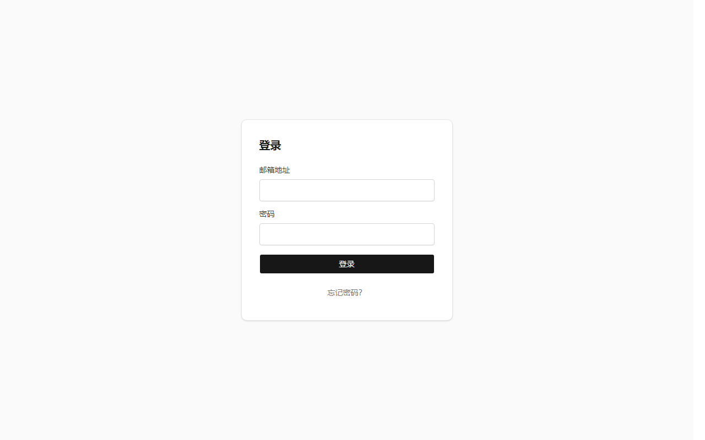
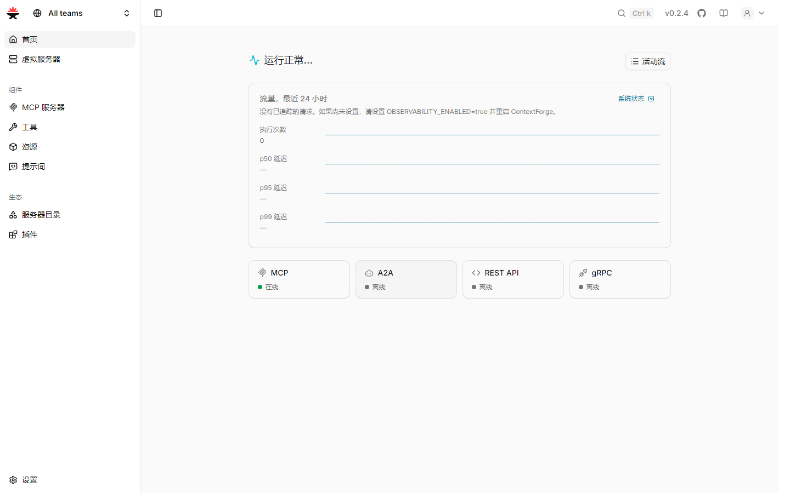
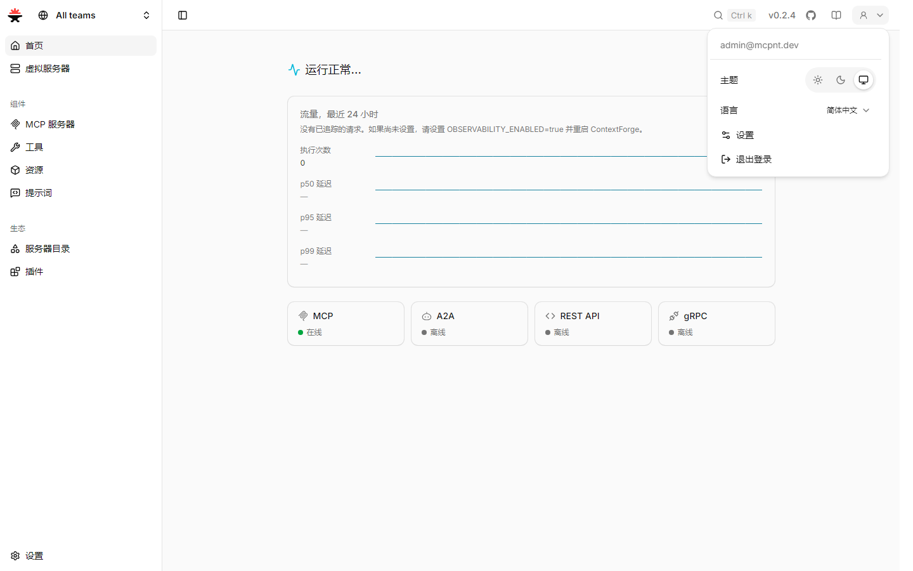
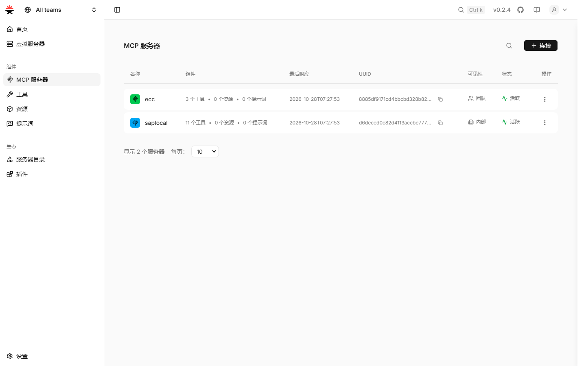

# ContextForge Web UI — 简体中文汉化版

本仓库是 [contextforge-org/contextforge-web-ui](https://github.com/contextforge-org/contextforge-web-ui)
的**简体中文汉化分支**，基于官方 `v0.2.4`（commit `3ab7b72`），在源码层新增 `zh-CN` 语言包，
其余代码与上游保持一致。

- 上游仓库：https://github.com/contextforge-org/contextforge-web-ui
- 基线版本：`v0.2.4`
- 许可：Apache-2.0（见 [LICENSE](LICENSE)、[THIRD-PARTY-NOTICES](THIRD-PARTY-NOTICES)）

## 汉化范围

上游前端已内建 [react-intl](https://formatjs.github.io/) 多语言框架，但只提供
`en-US` / `pt-BR` / `es-ES` 三个 bundle（右上角头像 → 语言 只有 English / Português / Español）。
本分支补齐**简体中文**：

| 文件                              | 改动                                                                  |
| --------------------------------- | --------------------------------------------------------------------- |
| `src/i18n/locales/zh-CN/`（新增） | 18 个 JSON + `index.ts`，共 **1545 条**译文，key 与 `en-US` 完全一致  |
| `src/i18n/types.ts`               | `SUPPORTED_LOCALES` 追加 `"zh-CN"`；`LOCALE_LABELS` 追加 `"简体中文"` |
| `src/i18n/IntlProvider.tsx`       | 注册 `zh-CN` bundle                                                   |
| `src/i18n/locales.test.ts`        | 同步注册（否则「每个支持语言都有 bundle」断言失败）                   |

语言菜单由 `src/components/layout/HeaderProfileMenu.tsx` 遍历 `SUPPORTED_LOCALES`
渲染，因此注册后自动出现，无需改组件。`detectUserLocale()` 对 `zh` / `zh-CN`
浏览器首次访问即自动命中；选择结果写入 `localStorage["user-locale"]`，刷新保持。

## 构建

```bash
npm ci                      # 或 npm ci --ignore-scripts（esbuild/rollup 二进制来自 optionalDependencies）
npx orval                   # 生成 src/generated/（被 gitignore，不跑会 tsc 报错）
npx vitest run src/i18n/locales.test.ts   # 18 项断言：key 对齐 / ICU 语法 / 占位符 / 富文本标签
npx tsc -b && npx vite build              # 产物输出到 server/public
```

要求 Node >= 22.22.1（见 `.nvmrc` / `package.json` 的 `engines`）。

## 打成镜像（overlay）

上游镜像只有编译产物，没有源码，因此汉化镜像只需替换 SPA 静态资源，不必重建 BFF：

```bash
# 构建上下文里要有 server/public
cp -r server/public /tmp/zh-build/public
cp deploy/Dockerfile.ui-zh /tmp/zh-build/Dockerfile

cd /tmp/zh-build
docker build --pull=false -f Dockerfile -t contextforge-web-ui:0.2.4-zh-CN .
```

## 验证记录

在部署实例上用 Playwright（headless Chrome）验证：

| 检查               | 结果                                                                                                                                  |
| ------------------ | ------------------------------------------------------------------------------------------------------------------------------------- |
| `locales.test.ts`  | 18 项断言全绿（key 集合/顺序、无空值、ICU 语法、`{arg}` 与 `<tag>` 形状与 `en-US` 一致）                                              |
| 语言下拉           | 4 项：`English` / `Português` / `Español` / `简体中文`，当前项高亮正确                                                                |
| 中文浏览器首次访问 | `<html lang=zh-CN>`，登录页显示 `登录 / 邮箱地址 / 密码 / 忘记密码？`                                                                 |
| 仪表盘             | `首页 / 虚拟服务器 / 组件 / MCP 服务器 / 工具 / 资源 / 提示词 / 生态 / 服务器目录 / 插件 / 设置`、`运行正常...`、`流量，最近 24 小时` |
| MCP 服务器列表     | `名称 / 组件 / 最后响应 / UUID / 可见性 / 状态 / 操作`、`3 个工具 · 0 个资源 · 0 个提示词`、`团队 / 内部`、`活跃`                     |
| 双向切换           | English ↔ 简体中文 即时生效，`<html lang>` 同步更新                                                                                   |
| 持久化             | `localStorage["user-locale"]` 生效，刷新后仍为中文                                                                                    |

截图（`docs/images/zh-CN/`）：

| 登录页                           | 仪表盘 + 语言菜单                    |
| -------------------------------- | ------------------------------------ |
|  |  |

| 语言下拉                                | MCP 服务器列表                     |
| --------------------------------------- | ---------------------------------- |
|  |  |

已知残留：左上角团队切换器的 `All teams` 在上游源码中为硬编码文本，未接入 i18n。

## 与上游同步

```bash
git remote add upstream https://github.com/contextforge-org/contextforge-web-ui.git
git fetch upstream
git merge upstream/main      # 若有冲突，优先取上游代码，再补 zh-CN 新增 key
```

上游已经比本分支基线（`v0.2.4`）新（`main` 领先 12 个提交，其中
`src/i18n/locales/en-US/dashboard.json`、`gateways.json` 有 key 变更）。
更新基线后必须重新跑 `npx vitest run src/i18n/locales.test.ts`，
把新增 key 补进 `zh-CN`，否则断言会失败。

## 贡献

译文问题（错译、术语不统一、ICU 占位符被译掉）欢迎直接提 Issue / PR。
术语约定：`Server` → 服务器、`Tools` → 工具、`Resources` → 资源、`Prompts` → 提示词、
`Virtual Servers` → 虚拟服务器、`Plugins` → 插件、`Teams` → 团队、`API tokens` → API 令牌；
`MCP` / `API` / `gRPC` / `JWT` / `OAuth` / `URL` / `UUID` 等专有名词不译。
